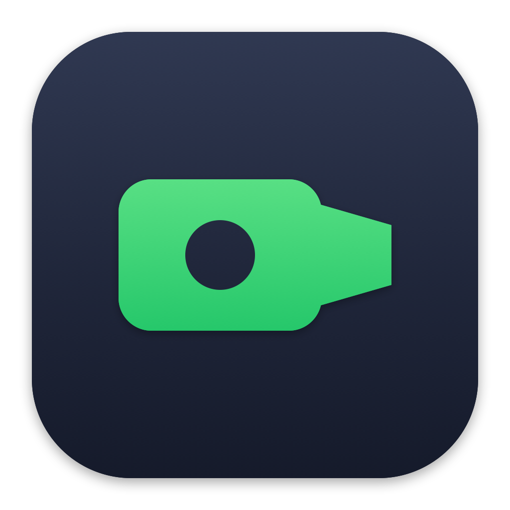
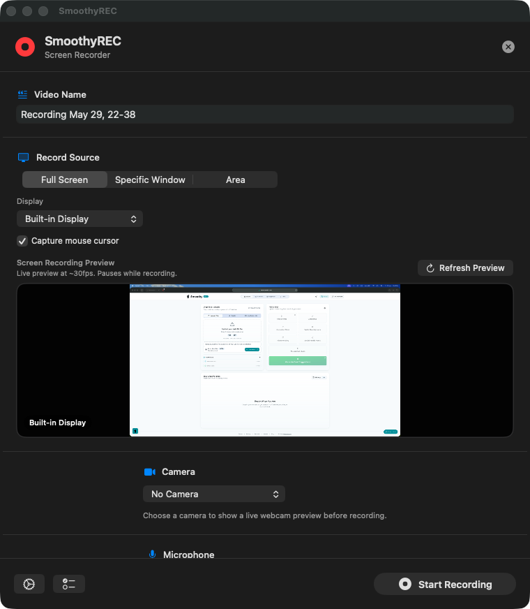
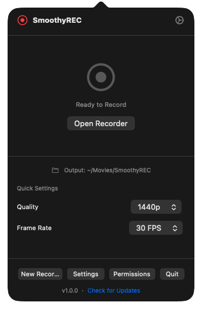
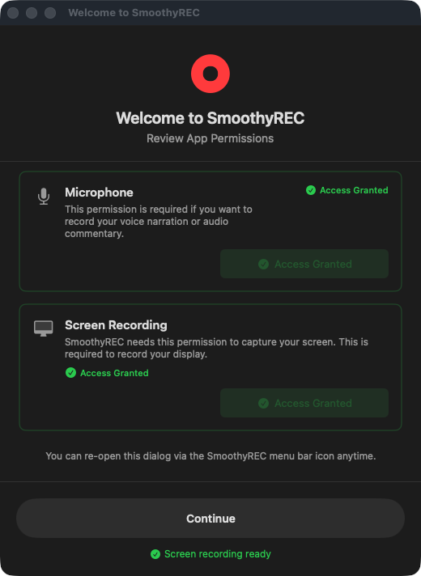

<div align="center">



# SmoothyREC

**The screen recorder you hand your client.**

A native macOS menu-bar recorder that captures the screen, the webcam, and the
microphone as **separate, independent files** — so the editor gets clean tracks
to cut, not one baked-in MP4.

[](https://www.apple.com/macos/)
[](https://swift.org)
[](https://developer.apple.com/xcode/swiftui/)
[](LICENSE)
[](#)

[**⬇︎ Download for macOS**](https://github.com/alibahrawy/SmoothyREC/releases/latest/download/SmoothyREC.dmg) · [Why it exists](#why-it-was-made) · [How it works](#how-it-works) · [Build from source](#build-from-source) · [smoothyedit.com](https://smoothyedit.com/smoothyrec)



</div>

---

## What it is

SmoothyREC is a lightweight, native macOS screen recorder built for one specific
moment: **the handoff between a client who records and an editor who edits.**

No project window, no scene/source setup. A non-editor opens it, picks a
quality, hits **Start**, hits **Stop** — from the window or straight from the
menu bar timer. What comes back is the part that matters to the editor: each
source written to its own file.

- 🎬 **Screen** → its own video file
- 📷 **Webcam** → its own video file (never burned into the screen)
- 🎙️ **Microphone** → its own audio file
- 🔊 **System audio** → captured alongside, kept isolated

Drop those straight onto a timeline and reframe the webcam, re-time the mic, or
recut the screen — each on its own track, exactly like footage you shot yourself.

> **Built by an editor, for editors.** Free forever. Part of the
> [Smoothy](https://smoothyedit.com) suite.

---

## Why it was made

Every screen recorder on the market is built for **the person editing the footage**
— or it flattens everything the instant you stop. Neither fits the most common
real-world workflow for a video editor:

> *"Record yourself going through this, and send it to me."*

When you tell a client to do that, three things go wrong:

| The tool they reach for | What you get back |
| --- | --- |
| **Pro tools** (OBS & friends) | Scenes, sources, encoders — so you end up on a screen-share call walking them through setup. |
| **Quick recorders** | A single flattened MP4 with the webcam burned into a corner and audio glued to picture. Nothing to cut. |
| **Nothing in between** | No app is *dead simple for the client* yet *produces footage that's a joy for the editor.* |

SmoothyREC is that missing middle. The client experience is three clicks. The
editor experience is separate, edit-ready tracks. That single rule — **hand the
editor separate files, never one baked-in MP4** — is the entire reason this app
exists, and it shapes every design decision inside it.

---

## Features

| | |
| --- | --- |
| 🧩 **Separate tracks** | Screen, webcam, and mic each land as their own file in one tidy per-recording folder. |
| 🪟 **Menu bar + Dock** | A live recording timer in the menu bar, a normal Dock presence so the app always reads as open. Close the window and it keeps running; quit and everything goes with it. |
| 🖥️ **Up to 4K · 60 FPS** | Quality presets from 720p to 4K; frame rates of 24 / 30 / 60. |
| 🎯 **Full screen, window, or area** | Record an entire display, a single window, or a dragged-out region. |
| 📷 **Picture-in-picture (optional)** | Want a combined file too? Export a PiP version *on top of* the separate tracks. |
| 🔊 **System audio + mic, isolated** | Capture both at once and keep them apart. |
| 🧭 **Guided first-run** | A one-time onboarding walks the client through macOS permissions in plain language. |
| ⏯️ **Pause / resume / countdown** | Pause mid-take; optional countdown before recording starts. |
| ⌨️ **Global hotkeys** | Start/stop and pause without bringing the app forward. |
| 🪶 **Light & native** | Pure Swift + SwiftUI + ScreenCaptureKit. The whole app is a few MB. |

<div align="center">

&nbsp;&nbsp;

</div>

---

## Install

### Download the app

1. **[Download `SmoothyREC.dmg`](https://github.com/alibahrawy/SmoothyREC/releases/latest/download/SmoothyREC.dmg)** from the latest release.
2. Open the DMG and drag **SmoothyREC** into your **Applications** folder.
3. Launch **SmoothyREC** from Applications. Version **1.1.1** is Developer ID signed and notarized for Apple silicon Macs running macOS 13 or later.

### Anonymous usage counts

Settings → General → **Share anonymous usage counts** controls reports of a random
installation ID, app version and action IDs. Recordings, filenames, paths, device
names and account details are never included. Reports are best effort and never
block recording or exports. Set `SMOOTHY_TELEMETRY=0` to disable them from the
environment. Download starts and recorder activity have a separate private
SmoothyREC Admin tab; they are not added to SmoothyEdit or Studio counts.

### Grant permissions

On first launch SmoothyREC asks for the macOS permissions it needs. The
onboarding screen walks you through each one:

| Permission | Required? | Used for |
| --- | --- | --- |
| **Screen Recording** | ✅ Required | Capturing your screen |
| **Microphone** | Optional | Recording mic audio as its own track |
| **Camera** | Optional | Recording the webcam as its own track |

Grant them in **System Settings → Privacy & Security**, then relaunch when
prompted. (macOS keys these permissions to the app's code signature — see
[`setup-dev-certificate.sh`](setup-dev-certificate.sh) for why a stable signature
matters when building from source.)

---

## How it works

SmoothyREC's defining trait — separate files that stay perfectly in sync — comes
from running **three independent recorders against one shared clock** and writing
each to its own AVFoundation file. Here's the shape of it:

```
                        ┌─────────────────────────────┐
                        │     RecordingCoordinator     │   @MainActor
                        │  • owns one shared CMClock   │   (the conductor)
                        │  • one per-recording folder  │
                        └───────────────┬─────────────┘
              syncTime = CMClockGetTime(hostTimeClock)
        ┌───────────────────────┼───────────────────────┐
        ▼                       ▼                       ▼
┌───────────────┐      ┌────────────────┐      ┌────────────────┐
│ ScreenRecorder│      │  MicRecorder   │      │ CameraRecorder │
│ ScreenCapture │      │  AVCapture →   │      │  AVCapture →   │
│ Kit (SCStream)│      │  AVAssetWriter │      │  AVAssetWriter │
└───────┬───────┘      └───────┬────────┘      └───────┬────────┘
        ▼                      ▼                       ▼
   screen.mp4 / .mov        mic.m4a               camera.mov
        └───────────── one per-recording folder ──────────────┘
```

### The coordinator ([`RecordingCoordinator.swift`](SmoothyREC/RecordingCoordinator.swift))

A `@MainActor ObservableObject` that conducts the session:

- **One shared sync clock.** At `start()`, it grabs `CMClockGetHostTimeClock()` and
  reads a single `syncTime`. The camera writer starts its session *at that exact
  timestamp* (`writer.startSession(atSourceTime: syncTime)`), so the camera and
  screen line up frame-accurately on the timeline instead of drifting.
- **One output folder.** It resolves a single per-recording directory up front
  (`Title/`, then `Title 2/`, `Title 3/` for repeats) and hands the same folder to
  every recorder, so all three files land together and never collide.
- **Screen is primary; mic & camera are optional.** The screen recorder must
  succeed. The mic and camera start *concurrently* in a `TaskGroup`; if either
  fails it's recorded as a non-fatal **warning**, and the session still produces a
  usable screen recording.
- **Synchronized lifecycle.** `pause` / `resume` / `stop` fan out to all three
  recorders at once (via `TaskGroup`), and pause/resume compensates the start time
  so the displayed duration stays correct.

### Screen capture ([`ScreenRecorder.swift`](SmoothyREC/ScreenRecorder.swift))

Built on **ScreenCaptureKit** with two code paths, chosen by OS version:

- **macOS 15+** → uses the system-native `SCRecordingOutput`, which writes an
  `.mp4` (H.264) directly. Less code, less CPU, fewer chances for drift.
- **macOS 13–14** → falls back to a manual pipeline: an `SCStream` delivers
  `CMSampleBuffer`s to a serial writer queue that feeds an `AVAssetWriter`
  (`.mov`), trying **H.264** first and **HEVC** as a fallback codec. System audio
  is encoded to AAC (48 kHz stereo) on its own writer input.

The target can be a **full display**, a **single window** (`SCContentFilter(desktopIndependentWindow:)`),
or a **dragged-out area** (`SCStreamConfiguration.sourceRect`). Capture is sized
from quality presets and snapped to even dimensions so every codec accepts it.

| Preset | Resolution | Video bitrate |
| --- | --- | --- |
| Low | 1280 × 720 | 5 Mbps |
| Medium | 1920 × 1080 | 10 Mbps |
| High | 2560 × 1440 | 20 Mbps |
| Ultra | 3840 × 2160 | 40 Mbps |

### Microphone & camera ([`MicRecorder.swift`](SmoothyREC/MicRecorder.swift) · [`CameraRecorder.swift`](SmoothyREC/CameraRecorder.swift))

Each runs its own `AVCaptureSession` and writes its own file:

- **Mic** → AAC in an `.m4a` container.
- **Camera** → HEVC in a `.mov` container, its writer session pinned to the shared
  `syncTime`.

Because they're separate `AVAssetWriter`s, a failure in one never corrupts the
others — and the editor gets discrete tracks instead of a flattened mix.

### Optional picture-in-picture ([`PiPCompositor.swift`](SmoothyREC/PiPCompositor.swift))

When you *do* want a single ready-to-share file, `PiPCompositor` builds an
`AVMutableComposition` that overlays the camera track onto the screen track and
mixes the audio — producing one combined export **in addition to**, never instead
of, the separate source files.

### Concurrency model

Real-time capture is threading-heavy, so SmoothyREC is deliberate about it:
the public API is `@MainActor`, raw sample buffers are handled on dedicated
serial dispatch queues, shared writer state is guarded by `NSLock`, and the async
boundaries to ScreenCaptureKit's delegate callbacks are bridged with
`CheckedContinuation`s. Concurrent start/stop across the three recorders uses
`withTaskGroup`.

### Output layout

Every recording is a self-contained folder:

```
~/Movies/SmoothyREC/
└── Client Walkthrough/
    ├── Client Walkthrough_screen_2026-06-06_14-22-08.mp4
    ├── Client Walkthrough_mic_2026-06-06_14-22-08.m4a
    └── Client Walkthrough_camera_2026-06-06_14-22-08.mov
```

These are standard files. Drop them straight into SmoothyEdit, SmoothyDesktop,
Premiere, Final Cut, Resolve — anything.

For a deeper dive (delegate flow, error/warning model, signing rationale), see
**[`docs/ARCHITECTURE.md`](docs/ARCHITECTURE.md)**.

---

## Build from source

**Requirements:** macOS 13+, Xcode 15+ (developed against Xcode 26).

```bash
git clone https://github.com/alibahrawy/SmoothyREC.git
cd SmoothyREC

# Optional but recommended: create a stable local signing identity so macOS
# remembers your Screen Recording permission across rebuilds.
./setup-dev-certificate.sh

# Build a debug app and run it
./build-dev.sh
open build/SmoothyREC.app
```

### Build a release DMG

```bash
# Release build (unsigned / ad-hoc), then package the installer
xcodebuild build -project SmoothyREC.xcodeproj -scheme SmoothyREC \
  -configuration Release -derivedDataPath build/DerivedData \
  CODE_SIGNING_ALLOWED=NO
cp -R build/DerivedData/Build/Products/Release/SmoothyREC.app build/
codesign --force --deep --sign - \
  --entitlements SmoothyREC/SmoothyREC.entitlements build/SmoothyREC.app

brew install create-dmg            # one-time
./create-dmg.sh build . SmoothyREC.dmg "SmoothyREC Installer"
```

### Signed & notarized build (with a paid Apple Developer ID)

```bash
export DEVELOPER_ID='Developer ID Application: Your Name (TEAMID)'
./build-and-sign.sh
```

This signs, builds a DMG, submits it to Apple for notarization, and staples the
ticket — producing a build with no Gatekeeper warning.

---

## Project structure

```
SmoothyREC/
├── SmoothyREC/
│   ├── SmoothyRECApp.swift           # @main entry + NSApplicationDelegate
│   ├── AppDelegate+StatusBar.swift   # Menu-bar (NSStatusItem) setup
│   ├── AppDelegate+Windows.swift     # Window lifecycle
│   ├── AppDelegate+Notifications.swift
│   ├── RecordingCoordinator.swift    # ★ Conducts the three recorders + sync clock
│   ├── ScreenRecorder.swift          # ★ ScreenCaptureKit capture engine
│   ├── CameraRecorder.swift          # ★ Webcam capture engine (synced)
│   ├── MicRecorder.swift             # ★ Microphone capture engine
│   ├── PiPCompositor.swift           # Optional combined PiP export
│   ├── RecordingSupport.swift        # Shared types + output-file resolver
│   ├── DeviceManager.swift           # Camera/mic/display enumeration
│   ├── SettingsManager.swift         # User preferences
│   ├── HotKeyManager.swift           # Global keyboard shortcuts
│   ├── *View.swift                   # SwiftUI: onboarding, recorder, settings, completion
│   ├── *Overlay.swift / *Manager.swift # Countdown, region select, previews
│   ├── Assets.xcassets/              # App + menu-bar icons
│   ├── SmoothyREC.entitlements       # screen-recording / camera / mic / no-sandbox
│   └── Info.plist                    # LSUIElement + usage descriptions
├── SmoothyRECTests/                  # Unit tests (output-file resolver, etc.)
├── docs/
│   ├── ARCHITECTURE.md               # Deep "how it works"
│   └── images/                       # Screenshots used in this README
├── build-dev.sh                      # Quick debug build (+ stable signing)
├── build.sh / build-and-sign.sh      # Release / signed+notarized builds
├── create-dmg.sh                     # DMG installer packaging
├── setup-dev-certificate.sh          # One-time stable dev signing identity
└── README.md
```

---

## Where it fits in the Smoothy suite

SmoothyREC is the **capture** front-end of the [Smoothy](https://smoothyedit.com)
toolset — the thing you hand a non-editor:

- Recordings open in **SmoothyDesktop** as a ready-made multi-track project.
- Each track also works in **SmoothyEdit**, since they're standard video/audio files.
- It's deliberately *not* an editor and *not* a live-streaming tool — it does one
  job, the handoff, well.

→ Learn more at **[smoothyedit.com/products/smoothy-rec](https://smoothyedit.com/smoothyrec)**

---

## Keyboard shortcuts

| Shortcut | Action |
| --- | --- |
| `⌃⌘R` | Start / Stop recording |
| `⌃⌘P` | Pause / Resume |
| `⌃⌘S` | Open Settings |

---

## FAQ

**Is it really free?** Yes — free forever, MIT-licensed, source in this repo.

**Is the download signed?** Yes. The official 1.1.1 Apple silicon release is
Developer ID signed, notarized by Apple and distributed with a stapled ticket.
Source builds use the developer's own signing configuration.

**Where do recordings go?** Into a per-recording folder under your chosen output
location (Movies by default), with the screen, mic, and camera files side by side.

**Can it make one combined file?** Yes — enable picture-in-picture to also export
a single merged file alongside the separate tracks.

**Does it stream?** No. SmoothyREC is for clean recorded takes, not live broadcast.

---

## License

[MIT](LICENSE) © Ali Bahrawy

Built with [SwiftUI](https://developer.apple.com/xcode/swiftui/),
[ScreenCaptureKit](https://developer.apple.com/documentation/screencapturekit),
and [AVFoundation](https://developer.apple.com/documentation/avfoundation).
</content>
</invoke>
